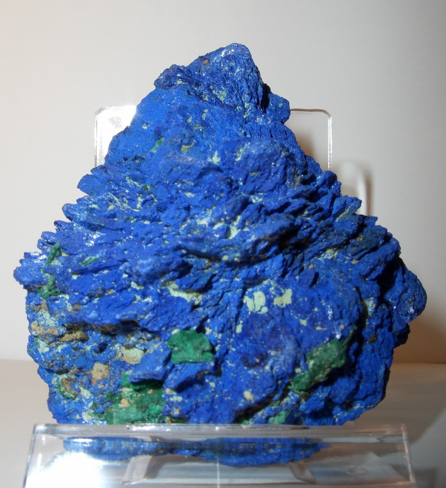
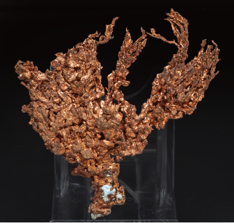
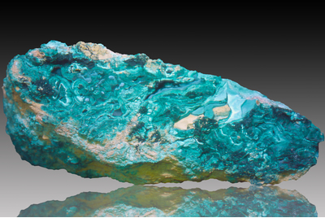
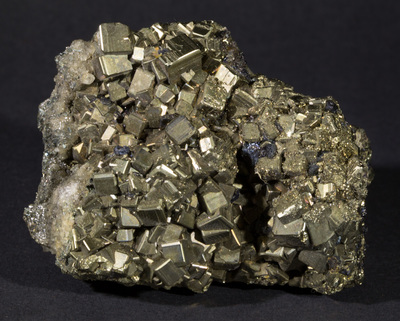
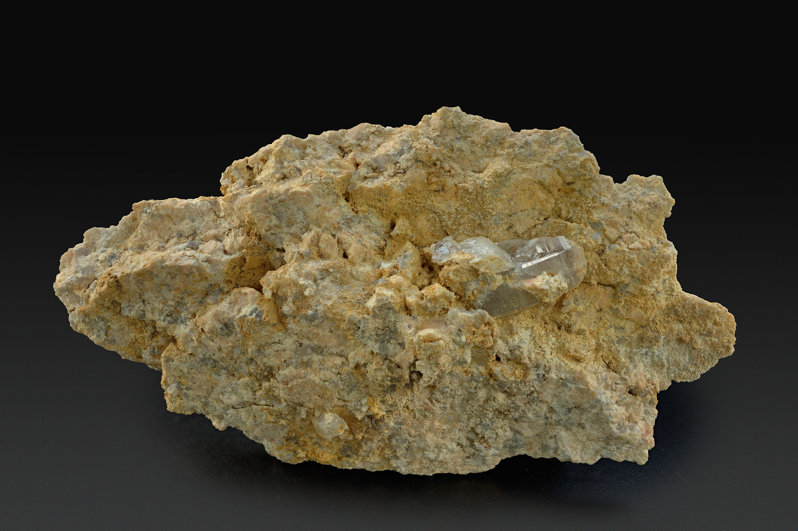
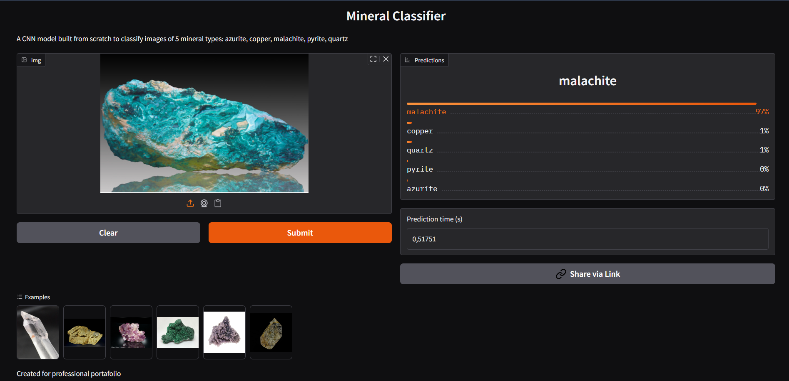

# 🌋 Mineral Classifier

**Mineral image classification using a custom-built CNN**

This project showcases a deep learning model capable of classifying
mineral images into five categories: **azurite**, **copper**,
**malachite**, **pyrite**, and **quartz**.\
The model was built from the ground up using a **custom Convolutional
Neural Network (CNN)**, trained with PyTorch, and deployed as an
interactive demo on Hugging Face.

------------------------------------------------------------------------

## 🚀 Live Demo

Try the model directly on Hugging Face Spaces:

👉 https://huggingface.co/spaces/baalboza/mineral_classifier

------------------------------------------------------------------------

## 🧠 Model Architecture

The classifier is based on a **fully custom CNN architecture**, designed
without transfer learning to practice low-level neural network
implementation.

It includes:

-   Convolutional layers + SiLU\
-   MaxPooling\
-   Fully Connected layers\
-   Dropout regularization\
-   Adam optimizer

------------------------------------------------------------------------

## 🗂️ Dataset

Dataset used:

📦 **Mineral Photos (Kaggle)**\
https://www.kaggle.com/datasets/floriangeillon/mineral-photos

The original dataset contains 15 mineral types.\
This project uses only the following 5, chosen for their relevance to
Chilean mineral deposits:

-   **Azurite**\
-   **Copper**\
-   **Malachite**\
-   **Pyrite**\
-   **Quartz**

The goal of the project is to practice neural networks applied to mining
and build a strong data science portfolio.

------------------------------------------------------------------------

## 📊 Results

### **📌 Test Accuracy:** **85.65%**

------------------------------------------------------------------------

## 🖼️ Example Gallery

These spaces are ready for your real dataset images.

### 🔹 Representative samples per class

  -------------------------------------------------------------------------------------------------------------------------------------------------------------------
  Azurite                          Copper                          Malachite                          Pyrite                          Quartz
  -------------------------------- ------------------------------- ---------------------------------- ------------------------------- -------------------------------
              

  -------------------------------------------------------------------------------------------------------------------------------------------------------------------

------------------------------------------------------------------------

### 🔹 Sample model prediction

**Prediction:** Malachite\
**Confidence:** 0.97

------------------------------------------------------------------------

### 🔹 Hugging Face Demo Preview

------------------------------------------------------------------------

## 🧩 Project Structure

    Mineral-Classifier/
    │
    ├── app.py                  # Gradio demo for Hugging Face
    ├── mineral_classifier.pth  # Trained model
    ├── exploration.ipynb       # Notebook with all exploration process
    ├── new_dataset.py          # Dataset loading and preprocessing
    ├── utils.py                # Saving model code
    ├── helper_functions.py     # Plotting functions
    ├── README.md
    └── example_images/         # Folder for images used in the README

------------------------------------------------------------------------

## 🛠️ Technologies Used

-   Python\
-   PyTorch\
-   Gradio\
-   Hugging Face Spaces\
-   NumPy\
-   Pandas\
-   Matplotlib\
-   Git / GitHub

------------------------------------------------------------------------

## 🎯 Project Purpose

This project is part of my portfolio as a **Metallurgical Engineer**
specializing in **Data Science and Machine Learning applied to mining**.

It demonstrates skills in:

-   Image preprocessing\
-   Building CNNs from scratch\
-   Model training and evaluation\
-   Deploying real ML apps on Hugging Face

------------------------------------------------------------------------

## 📞 Contact

**Author:** Bastián Albornoz\
🔗 LinkedIn: https://www.linkedin.com/in/bastian-albornoz-e/
📧 Email: bastian.alejandro.a@gmail.com
